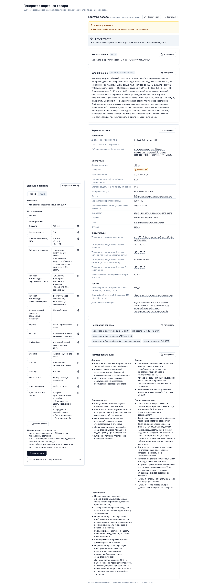
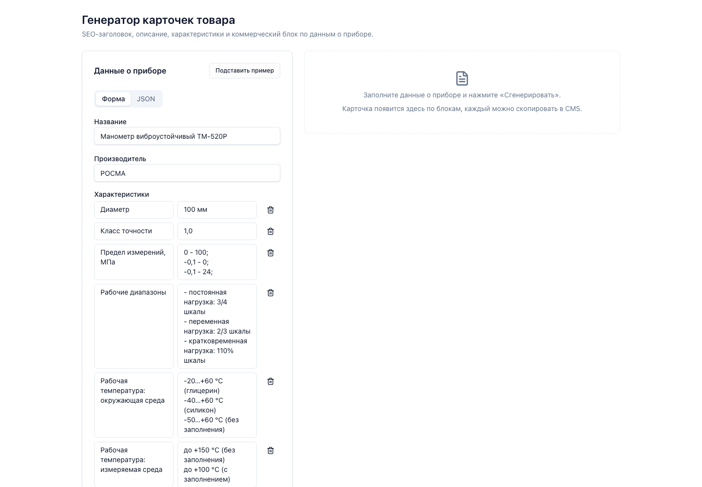
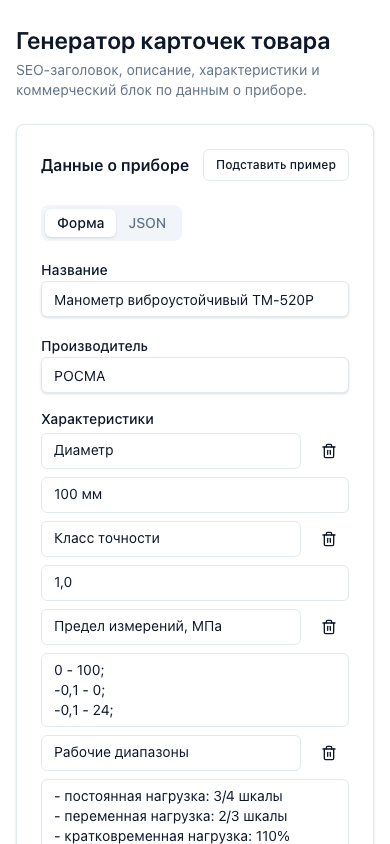
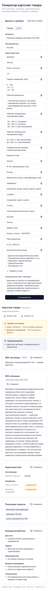

# AI-помощник для карточек товаров «Союз-Прибор»

Из названия, характеристик и описания прибора делает черновик карточки для интернет-магазина КИП: SEO-заголовок, SEO-описание, таблицу характеристик, поисковые запросы и блок для менеджера. Чего нет во входе, модель не придумывает: в карточке стоит «данных нет», а вопрос попадает в список «Требует уточнения». Условие задания — [docs/task.md](docs/task.md).

**Демо:** https://souz-pribor-test.vercel.app — открыто, без входа. Работает на бесплатной `glm-4.5-flash` (Z.ai), у неё жёсткий лимит запросов: при ошибке «Превышен лимит запросов» повторите через минуту.



## Быстрый старт

Нужен Node.js 22.13 или новее.

```bash
npm ci
cp .env.example .env     # впишите LLM_API_KEY; без ключа отдаётся заглушка
npm run dev              # интерфейс http://127.0.0.1:5173, API :3000
```

Другие способы запуска:

- `npm start` — собрать фронт и отдать его вместе с API одним процессом на http://127.0.0.1:3000.
- `npm run generate -- examples/tm-520r.json` — CLI: рядом с входом появятся `tm-520r.card.json` и `tm-520r.card.md`. Без файла CLI читает JSON со stdin и печатает карточку в stdout.
- `curl -X POST http://127.0.0.1:3000/api/generate -H 'content-type: application/json' -d '{"name":"Манометр ТМ-520Р"}'` — API. Описание API — Swagger UI на `/api/docs`.
- Проверки: `npm run typecheck && npm test && npm run lint && npm run build && npm run e2e` (для e2e один раз: `npx playwright install chromium`).

Без ключа сервер и CLI работают на статичной карточке-заглушке: так можно посмотреть интерфейс, не тратя запросы.

## Пример входа и выхода

Вход — JSON из ТЗ (все поля, кроме `name`, необязательны):

```json
{
  "name": "Манометр показывающий DM 02",
  "manufacturer": "Манотомь",
  "specs": { "диапазон измерений": "0–1,6 МПа", "класс точности": "1,5", "присоединение": "G1/2", "диаметр корпуса": "100 мм" },
  "description": "Прибор предназначен для измерения избыточного давления..."
}
```

Готовые прогоны лежат в [examples/](examples/). Для каждого товара есть вход (`*.json`), карточка (`*.card.json`) и она же в Markdown (`*.card.md`) — в таком виде её удобно вставлять в CMS:

| Товар | Что проверяет | Вход | Результат |
|---|---|---|---|
| Манометр ТМ-520Р (РОСМА) | полные данные с souz-pribor.ru и выдержкой из руководства по эксплуатации, противоречие IP 54 / IP65 в источнике | [tm-520r.json](examples/tm-520r.json) | [.md](examples/tm-520r.card.md) · [.json](examples/tm-520r.card.json) |
| Датчик давления ОВЕН ПД100 | неполные данные: нет класса точности, IP, присоединения, температур | [pd100.json](examples/pd100.json) | [.md](examples/pd100.card.md) · [.json](examples/pd100.card.json) |
| DM 02 из ТЗ | пример из условия как есть | [dm02.json](examples/dm02.json) | [.md](examples/dm02.card.md) · [.json](examples/dm02.card.json) |

<!-- EXAMPLES_NOTE -->

Откуда взяты данные товаров и что в них проверяется, описано в [fixtures/README.md](fixtures/README.md).

## Как устроено

```
вход (форма / JSON / CLI)
  → проверка схемы и нормализация           src/core/input
  → тип прибора → обязательные поля          манометр, датчик, термометр
  → промпт                                   src/core/prompts
  → модель (Anthropic или OpenAI-совместимый формат)   src/core/llm
  → проверки кодом                           src/core/checks
      нарушения есть → повтор с текстом ошибок (до 2 раз)
  → очистка неподтверждённого → карточка + предупреждения
```

Один и тот же вызов `generateCard()` используют сервер (Fastify, `src/server`), CLI (`src/cli`) и функция Vercel. Типы входа и выхода заданы схемами zod в `src/contract`; сервер проверяет по ним и запрос, и ответ.

Интерфейс (`src/web`, React + Vite + Tailwind) показывает каждый блок с кнопкой «Копировать», счётчики длины (заголовок ≤ 70, описание 800–1200 символов), «данных нет» выделено цветом, у значения из входа во всплывающей подсказке видна цитата-источник. Карточку можно скачать в `.json` и `.md`.

## Промпты и почему так

Все тексты промптов — константы в [src/core/prompts/index.ts](src/core/prompts/index.ts), они читаются без знания кода.

- **Системный промпт объясняет, зачем запрет на выдумки.** Не просто «не придумывай», а почему: карточку читают инженеры и снабженцы, неверный диапазон или резьба ведут к поставке не того прибора и возврату. С объяснением модель реже «дописывает типичное».
- **Данные отделены от инструкций тегами** `<product_data>`, `<required_specs>`, `<instructions>`. Текст описания — это данные, а не команды (во входах есть пример с prompt injection: `fixtures/edge/prompt-injection.json`).
- **Код заранее говорит модели, каких полей не хватает.** По типу прибора есть список обязательных характеристик (у манометра — диапазон, класс точности, присоединение, диаметр, IP, температура среды; у датчика ещё выходной сигнал и питание). Отсутствующие передаются в `<required_specs>`, и модель обязана поставить «данных нет» и задать вопрос менеджеру, а не промолчать.
- **У каждого значения — источник.** Модель возвращает `source: "input" | "missing"` и `source_quote` — дословный фрагмент входа. Это делает выдумку проверяемой.
- **Формулы для текстов.** Заголовок: тип + модель + производитель + 1–3 параметра, без «купить» и названия магазина. Описание: назначение → параметры → конструктив → применение. Основание — ресерч по SEO-карточкам: [docs/research/01-seo-product-card.md](docs/research/01-seo-product-card.md).
- **Один пример на другом приборе** (термометр), с оговоркой «берётся только форма»: пример на манометре модель могла бы перенести в ответ как данные.
- **Ответ — JSON по схеме.** Где провайдер это поддерживает, включён structured output (JSON Schema), иначе JSON по просьбе и разбор с допуском обёртки ```json.

## Защита от выдуманных характеристик

Модели не доверяем: после каждого ответа код сверяет его со входом.

1. **Цитаты.** Каждый `source_quote` должен дословно (с точностью до регистра, ё, тире, десятичной запятой) находиться во входе. Нет — значение заменяется на «данных нет».
2. **Числа и единицы.** Каждое число в характеристиках должно быть во входе. В свободном тексте (заголовок, описание, преимущества) проверяются пары «число + единица»: «100 мм» во входе не превратится в «100 МПа» в описании.
3. **Повторы.** Если есть нарушения или превышены длины, модель получает свой ответ и список ошибок и переписывает карточку. Всего до 3 попыток.
4. **Очистка.** Что не исправилось за 3 попытки, код убирает сам: характеристика → «данных нет», в описании выбрасывается предложение с выдуманным числом, в заголовке — фрагмент между запятыми. Всё убранное попадает в предупреждения («Требует уточнения»).
5. **Противоречия во входе** (например, IP 54 в таблице и IP65 в описании у ТМ-520Р) не исправляются молча, а показываются предупреждением.

Если модель ни разу не вернула разбираемый JSON, карточка собирается кодом только из входа, тексты помечаются как требующие написания.

**Слабое место.** Проверка ловит числа, единицы и цитаты, но не качественные утверждения: «устойчив к агрессивным средам» без чисел пройдёт, если модель его придумает. Список единиц фиксированный (давление, длина, температура, ток, напряжение, %), экзотические единицы сверяются только по числу. Противоречия во входе ищутся по IP, классу точности и дублю ключа.

## Модель и провайдер

Провайдер выбирается переменными окружения, код не меняется (`.env.example` содержит готовые блоки):

| Вариант | `LLM_PROVIDER` | `LLM_BASE_URL` | `LLM_MODEL` |
|---|---|---|---|
| OpenCode Zen, Claude | `anthropic` | `https://opencode.ai/zen/v1` | `claude-sonnet-5-5` |
| OpenCode Zen, другие модели | `openai-compatible` | `https://opencode.ai/zen/v1` | id модели из каталога Zen |
| Anthropic напрямую | `anthropic` | пусто | `claude-sonnet-5-5` |
| Z.ai (бесплатно) | `anthropic` | `https://api.z.ai/api/anthropic` | `glm-4.5-flash` |

Целевая модель — Claude Sonnet 5.5: хорошо держит русский деловой текст и длинные инструкции, поддерживает structured output. Дополнительно: `LLM_EFFORT` (только anthropic) и `LLM_STRUCTURED` (`auto` / `on` / `off`).

Примеры в `examples/` и демо сделаны на бесплатной `glm-4.5-flash` через Z.ai: рабочего ключа Zen на момент сдачи не было. На Claude качество текстов ожидаемо выше; защита от выдумок от модели не зависит, потому что работает в коде.

## Обработка ошибок

- Битый JSON на входе — ошибка со строкой и столбцом, до вызова модели. Пустое `name` — ошибка. Пустые поля считаются отсутствующими.
- Ошибки провайдера переводятся в сообщения по-русски с кодом ошибки (`llm_auth`, `llm_rate_limit`, `llm_timeout`, `llm_overloaded`, `llm_refusal` и др.) и `request_id`. HTTP-код ответа API: битый вход — 400, таймаут модели — 504, лимит запросов и перегрузка провайдера — 503, неверный ключ, отказ модели и прочие сбои провайдера — 502.
- Ответ модели не по схеме — повтор с текстом ошибки, после трёх неудач — черновик из входа.

## Заметка про DM 02 из ТЗ

В примере из ТЗ стоит «Манометр показывающий DM 02», производитель «Манотомь». В реальности ДМ 02 — модель ООО «МЕТЕР» (Санкт-Петербург, Госреестр СИ № 25264-08), а ОАО «Манотомь» (Томск) выпускает 100-миллиметровые манометры под другими названиями (МП3-У и др.). Подробно: [docs/research/01-seo-product-card.md](docs/research/01-seo-product-card.md).

Помощник это не исправляет: внешних справочников у него нет, а правило «только факты из входа» распространяется и на производителя. Поэтому `examples/dm02.json` взят из ТЗ как есть. В реальной работе такую пару «модель — производитель» стоит сверять по Госреестру до генерации.

## Ограничения и что улучшить

- **Meta description** отдельным полем (≤ 160 символов) — сейчас его роль выполняет начало SEO-описания.
- **Пакетная обработка:** загрузка CSV/XLSX каталога, очередь и выгрузка карточек пачкой.
- **Сравнение моделей** на eval-наборе из 20–30 реальных приборов: доля «данных нет», доля нарушений до повтора, длины.
- **Частоты Wordstat** для поисковых запросов — сейчас запросы составлены по шаблону, без данных о спросе.
- **Аналоги и сопутствующие товары** из каталога магазина.
- **Вторая проверка моделью** каждого утверждения описания против входа — закроет качественные выдумки, которые не ловит код.
- **Справочник категорий и единиц** вместо фиксированного списка; шаблоны обязательных полей для расходомеров, уровнемеров, термопреобразователей.

## Сознательно не делали

- БД, авторизацию, админку, CMS-интеграцию, RAG и векторную базу — по ТЗ не нужны.
- Docker и CI: для прототипа хватает `npm ci && npm run dev`.
- Внешние справочники (Госреестр, сайты производителей): помощник работает только по входу, чтобы любое значение в карточке можно было проследить до источника.
- Автоисправление противоречий во входе: решать, IP 54 или IP65, должен человек.
- Деплой ТЗ не требует. Демо на Vercel сделано, чтобы интерфейс можно было потрогать без установки.

## Скриншоты

| | Форма с примером | Результат |
|---|---|---|
| Компьютер |  |  |
| Телефон |  |  |

## Деплой на Vercel

`vercel.json`: статика Vite из `dist/web`, все запросы `/api/*` идут в функцию `api/index.js` (тот же Fastify, `maxDuration` 300 с — с запасом на генерацию с повторами). Сервер собирается одним бандлом скриптом [scripts/build-vercel.sh](scripts/build-vercel.sh): рантайм Vercel не поддерживает ESM-импорты без расширений и `require()` ESM-модулей в зависимостях. Переменные `LLM_*` задаются в настройках проекта Vercel.

## Структура

```
src/contract   схемы zod — единственный источник типов
src/core       входные данные, промпты, адаптеры LLM, проверки, конвейер, Markdown
src/server     Fastify: /api/generate, /api/health, Swagger UI, раздача фронта
src/web        интерфейс контент-менеджера
src/cli        npm run generate
fixtures       реальные товары и краевые входы для тестов
examples       прогоны на реальной модели
docs           ТЗ, ресерч, сопроводительное письмо
```
